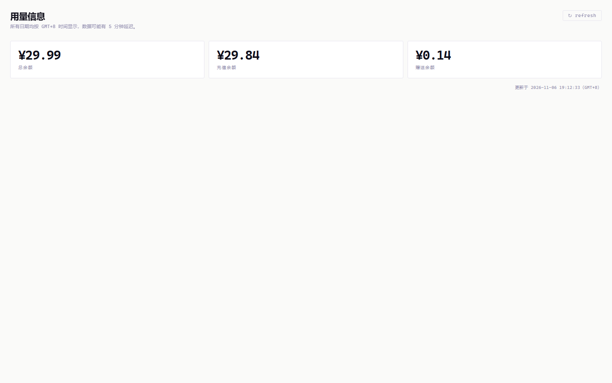

# DeepSeek 余额 · CloudCLI 插件



在 CloudCLI UI 里加一个“用量信息”标签页，显示 DeepSeek 账户余额，数据来自 DeepSeek 官方。每 5 分钟自动刷新，也可以点右上角 `↻ refresh` 手动刷新。

## API key 来源（按优先级）

1. 环境变量 `DEEPSEEK_API_KEY`
2. 环境变量 `ANTHROPIC_AUTH_TOKEN`
3. `~/.claude/settings.json` 的 `env.ANTHROPIC_AUTH_TOKEN`

key 只在插件后端进程内存和请求头里出现，不会写日志，也不会返回给前端。

## 构建

```bash
npm install
npm run build
```

## 安装到 CloudCLI

把整个目录（至少包含 `manifest.json`、`dist/`、`icon.svg`）复制到：

```
~/.claude-code-ui/plugins/deepseek-balance
```

然后刷新 CloudCLI 页面，在标签页里启用“DeepSeek 余额”。

也可以把本项目推到 Git 仓库，在 `Settings → Plugins` 里粘贴仓库 URL 安装。
